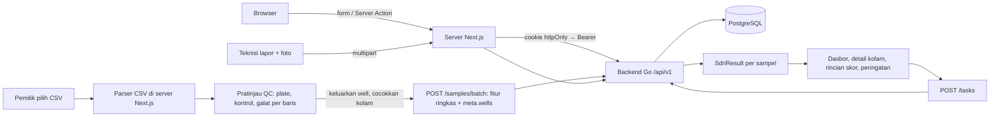

# 03 — ARCHITECTURE & Rencana Build

> Turunan dari 01-PRD. Prioritas: alur inti jalan stabil. ID task = ID di 04-TODO.
> Web adalah **frontend + BFF (backend-for-frontend) tipis** di atas backend Go tim. Semua data, auth, dan skor ada di backend; kontraknya di `docs/09-API-KONTRAK.md`.

## 1. Stack
| Lapisan | Pilihan | Alasan |
|---|---|---|
| Bahasa & framework | Next.js 16 (App Router) + TypeScript strict + React 19 | Dipilih user; landing (SSR/SEO) dan aplikasi dalam satu app |
| Backend | **Backend Go tim** (`Orang2-BU/AquaSeq-back`, net/http + PostgreSQL), dikerjakan rekan tim | Keputusan user: auth dan semua data lewat backend |
| Lapisan API di web | `src/lib/api/`: klien bertipe yang dipanggil hanya dari server (Server Component, Server Action, Route Handler). Dua implementasi: `live` (fetch ke backend) dan `mock` (data SIMULASI di memori), dipilih lewat `API_MODE` | Web bisa dibangun sebelum endpoint backend jadi; ganti ke live tanpa mengubah halaman |
| Auth | JWT access + refresh dari backend, disimpan server Next.js di cookie `httpOnly; Secure; SameSite=Lax`; refresh otomatis di `proxy.ts` | Browser tidak pernah memegang token; tanpa CORS |
| Skor | Dihitung **backend** (model logit V1-GSI, `probability_pct`, kelas 1-4). Web tidak menghitung skor | Keputusan user: SDRI ikut backend |
| Parser CSV qPCR | `src/lib/csv/` (TS murni, diadaptasi dari parser commit `2aad8c8`): baca CSV → well → ringkas Ct per sampel (rata-rata replikat yang tidak dikeluarkan) | Backend hanya menerima 12-15 fitur ringkas per sampel; data well dikirim di `meta` |
| Validasi | Zod di setiap Server Action dan Route Handler, juga untuk respons backend (parse, bukan cast) | Input klien dan respons backend sama-sama batas kepercayaan |
| Styling | Tailwind CSS v4 + token dari `designmd export` | Token 08-DESIGN jadi CSS variables |
| Komponen UI (aplikasi) | **Template Soft Op Dashboard**: kelas CSS + shell `starter/` | Keputusan user; template mengecualikan shadcn dan sidebar-21st (Q2) |
| Komponen UI (landing) | Komponen sendiri per section + Motion Primitives + `pill-link` | LANDING-PAGE §3, §5 |
| Animasi landing | `lenis` + `motion`, hanya di `(marketing)` | Pilihan user; tanpa GSAP |
| Visualisasi data | SVG sendiri (tren probabilitas, batang, heatmap plate 96-well) | Grafiknya sedikit dan spesifik |
| Ikon | `lucide-react`, stroke 1.75 | Satu keluarga ikon |
| Font | Onest + JetBrains Mono + Bricolage Grotesque (display landing) lewat `next/font/google` | Template + suara display landing |
| Test | Vitest (parser CSV, ringkasan Ct, validasi Zod, adapter API live vs skema, mock) | Ringan, kompatibel TS |
| Hosting | Web: Vercel Hobby. Backend: dikelola tim backend | `[asumsi]` |

## 2. Perintah Verifikasi & Setup
| Cek | Perintah |
|---|---|
| Install | `npm install` |
| Dev (mock) | `npm run dev` dengan `API_MODE=mock` (bawaan) |
| Dev (backend lokal) | jalankan backend: `go run ./cmd/server` di repo backend (port 8080), lalu `API_MODE=live API_BASE_URL=http://localhost:8080 npm run dev` |
| Test | `npm test` (`vitest run`) |
| Build | `npm run build` |
| Typecheck | `npm run typecheck` (`next typegen && tsc --noEmit`; typegen membuat tipe `LayoutProps`/rute) |
| Lint | `npm run lint` + `npm run format:check` |
| Dead code | `npx knip` |
| Token desain | `npx -p @google/design.md designmd lint docs/08-DESIGN.md` lalu `npx -p @google/design.md designmd export --format css-tailwind docs/08-DESIGN.md > src/styles/theme.css` |
| Kontrak | `npm test -- contract` (skema Zod respons diuji terhadap contoh di 09-API-KONTRAK dan, bila `API_MODE=live`, terhadap backend yang berjalan) |
| Alur inti | Manual dengan akun demo (mock atau live): daftar → lokasi + kolam → undang teknisi → catat air (teknisi) → unggah CSV contoh → pratinjau QC → kirim → dasbor + peringatan → buat tugas → lapor foto (teknisi) → tutup tugas |

Setup (sudah dijalankan 24 Okt 2026, Next.js 16.4.3):
```bash
npx create-next-app@16.4.3 <folder-sementara> --ts --tailwind --eslint --app --src-dir --import-alias "@/*" --use-npm   # lalu dipindah ke root (create-next-app menolak folder berisi docs/)
npm i zod lucide-react
npm i -D @types/node@^22 vitest prettier knip   # @types/node 22 mengikuti Node 22 dan peer vitest 5
# lenis + motion dipasang di T26 (landing), bukan sekarang, supaya tidak jadi dependency tak terpakai
# salin starter Soft Op (skill setup-project-00/design-templates/soft-ops-dashboard/starter/src) ke src/
# export token dari docs/08-DESIGN.md ke src/styles/theme.css
# adaptasi parser CSV dari commit 2aad8c8 (git show 2aad8c8:src/engine/parse/qpcr-csv.ts) ke src/lib/csv/
```
`.env.example`: `API_MODE=mock`, `API_BASE_URL=http://localhost:8080`, `SESSION_COOKIE_SECURE=false` (dev).

## 3. Model Data
> Sumber kebenaran data ada di backend (`sql/schema.sql` + tambahan di 09-API-KONTRAK). Web hanya memegang **tipe** (skema Zod di `src/lib/api/schemas.ts`) yang sama dengan kontrak.

| Entitas | Field kunci yang dipakai web | Endpoint | Halaman |
|---|---|---|---|
| User / sesi | `id, full_name, email, phone_wa, memberships[{farm_id, role}]` | `/auth/*` | P6-P12, P44 |
| Farm (lokasi) | `id, name, regency, provenance, archived_at` | `/farms` | P12, P27, pemilih lokasi |
| Pond (kolam) | `id, pond_code, name, system, area_sqm, current_cycle, assignee, wa_target, latest_result, latest_sampling_date` | `/farms/{id}/ponds`, `/ponds/{id}` | P13-P15, P39 |
| Member + Invitation | `user_id, full_name, role, active, pond_codes, open_tasks` / `email, pond_ids, expires_at` | `/farms/{id}/members`, `/invitations` | P11, P25, P26 |
| Batch (satu CSV) | `batch_id, lab_name, instrument, tested_at, sample_count, rejected_count` | `/samples/batch`, `/batches` | P17-P19 |
| Sample | `sample_id, sample_code, sampling_date, cycle_day, features, meta.wells, sdri_result, copies_per_ml, nh3_mg_l` | `/samples/{id}`, `/ponds/{id}/samples` | P15, P16 |
| SdriResult | `status, probability_pct, risk_class (1-4), risk_level, z_score, s_qpcr, s_bio, s_chem, model_version, recommendation` | tertanam di Pond/Sample | semua tampilan skor |
| Trajectory | `slope, trend, trajectory_alert, alert_message, history[]` | `/ponds/{id}/trajectory` | P13, P15 |
| WaterLog | `measured_at, temp_c, ph, do_mg_l, tan_mg_l, no2_mg_l, h2s_mg_l, tom_mg_l, alkalinity, salinity_ppt, transparency_cm, nh3_mg_l, recorded_by` | `/ponds/{id}/water-logs` | P15, P28, P38 |
| Alert | `kind, risk_class, probability_pct, message, since, acked_at, open_task_id` | `/farms/{id}/alerts` | P13, P22 |
| Task + TaskReport | `kind, title, instruction, due_at, status, owner_note, overdue` / `note, measured, photos` | `/tasks`, `/me/tasks` | P23, P24, P36, P37 |
| CycleOutcome | `cycle_number, outcome, actual_harvest_kg, outbreak_date, primary_suspect_pathogen` | `/cycles/outcome` | modal di P15 |
| Notification, Activity | `kind, title, read_at` / `actor, action, at` | `/me/notifications`, `/farms/{id}/activity` | P31, P32 |

Pemetaan kelas backend → UI (satu tempat: `src/lib/risk.ts`):

| `risk_class` / `status` | `probability_pct` | Label UI | Token warna |
|---|---|---|---|
| 1 `AMAN` | < 5% | Aman | `risk-aman` |
| 2 `WASPADA_RINGAN` | 5-25% | Waspada ringan | `risk-ringan` |
| 3 `WASPADA_TINGGI` | 25-60% | Waspada tinggi | `risk-tinggi` |
| 4 `BAHAYA` | ≥ 60% | Bahaya | `risk-bahaya` |
| `REJECTED_*` | - | Ditolak (alasan + "uji ulang") | netral |

## 4. Integrasi & Alur Sistem
- **Integrasi pihak ketiga:** hanya backend tim. `wa.me` (tautan). Tidak ada layanan lain di web.
- **Alur sistem:**

- **Baca data:** Server Component memanggil `api.<entitas>.<aksi>()` dari `src/lib/api`. Respons divalidasi Zod. `401` → `proxy.ts` mencoba refresh sekali, gagal → `/masuk`. `403` → `/akses-ditolak`.
- **Mutasi:** Server Action: validasi Zod → panggil API → `revalidatePath` → kembalikan `{ ok, data } | { ok: false, error, fieldErrors }` (galat backend `VALIDATION_ERROR.fields` dipetakan ke field form).
- **Foto laporan:** dikompres di browser (canvas, ≤ 1 MB, tanpa library), dikirim ke Server Action sebagai `FormData`, diteruskan multipart ke backend. Ditampilkan lewat Route Handler `/api/files/[id]` yang meneruskan token (browser tidak memanggil backend langsung).
- **Kalkulator landing:** Route Handler `/api/kalkulator` (publik, rate limit sederhana per IP di memori) → `POST /sdri/preview`. Bila backend tidak terjangkau: tampilkan 5 arketipe GSI statis dari `content/landing.ts` dengan label "contoh tersimpan".
- **Mode mock:** `src/lib/api/mock/` mengimplementasikan antarmuka yang sama dengan data SIMULASI di memori server (direset saat server restart). Skor di mock diambil dari tabel contoh tetap (5 arketipe GSI + variasi), bukan dihitung ulang, supaya web tidak punya salinan rumus.
- **Struktur folder:**
```
src/
├─ app/
│  ├─ (marketing)/            # Area Landing: layout + SmoothScroll + navbar/footer landing
│  │  ├─ page.tsx             # hanya merangkai section
│  │  ├─ metode/ kontak/ privasi/ syarat/
│  ├─ (auth)/                 # SoloFrame: masuk, daftar, verifikasi, lupa-sandi, atur-sandi, undangan/[token]
│  ├─ (app)/                  # Area Aplikasi: AppShell Soft Op, TANPA Lenis
│  │  ├─ app/ mulai/ dasbor/ kolam/ sampel/ lab/ peringatan/ tugas/ tim/ lokasi/
│  │  ├─ kimia-air/ laporan/ banding/ aktivitas/ notifikasi/ pengaturan/ bantuan/
│  │  └─ teknisi/             # tugas saya, tugas/[taskId], catat-air, kolam
│  ├─ api/                    # kalkulator (publik), files/[id] (proxy foto)
│  ├─ akses-ditolak/ pemeliharaan/ not-found.tsx error.tsx
│  └─ layout.tsx
├─ components/
│  ├─ shell/ solo/ ui/        # dari starter Soft Op
│  ├─ app/                    # komponen layar aplikasi
│  ├─ marketing/sections/     # satu file per section landing
│  └─ motion/                 # smooth-scroll + Motion Primitives yang dipakai
├─ content/landing.ts         # semua teks landing + 5 arketipe cadangan kalkulator
├─ lib/
│  ├─ api/                    # index.ts (pilih live/mock), live/, mock/, schemas.ts (Zod), errors.ts
│  ├─ auth/                   # cookie sesi, refresh, getSession()
│  ├─ csv/                    # parser qPCR + ringkasan Ct per sampel
│  ├─ risk.ts                 # pemetaan kelas backend → label + token
│  ├─ nav.ts                  # registry halaman dari PRD §5
│  └─ motion.ts               # token gerak landing
├─ styles/theme.css           # hasil designmd export
└─ proxy.ts                   # refresh sesi + pelindung rute + redirect peran
```
- **Keamanan & privasi dasar:**
  - Token hanya di cookie `httpOnly; Secure; SameSite=Lax`; tidak pernah dikirim ke JavaScript browser atau di-log.
  - Server Actions Next.js sudah memeriksa header Origin (CSRF); Route Handler mutasi tidak dibuat selain yang tercantum.
  - Otorisasi sebenarnya di backend (09-API-KONTRAK §9); web juga menyembunyikan menu/aksi yang tidak boleh untuk perannya, tapi tidak menganggapnya sebagai pengaman.
  - Semua input divalidasi Zod di server; CSV maks 2 MB dan hanya `text/csv`; foto hanya gambar, maks 4.
  - Respons backend divalidasi Zod; respons tidak sesuai skema → galat terkontrol, bukan crash.
  - Secret di `.env.local`; `.env.example` tanpa nilai asli.

## 6. Rencana Build
Milestone → task ≤ ½ hari. Pemilik semua task: Krisna. Endpoint backend yang dibutuhkan tiap task tercantum supaya bisa dikoordinasikan dengan tim backend.

| ID | Milestone | Task | Fitur | Endpoint | Kriteria selesai |
|---|---|---|---|---|---|
| T1 | Fondasi | Scaffold Next.js + tooling (ESLint, Prettier, Vitest, knip, typecheck) + `.env.example` | — | — | lint/typecheck/test/build/knip hijau |
| T2 | Fondasi | Token 08-DESIGN + starter Soft Op + nav PRD + placeholder halaman Must/Should | — | — | Shell lolos verifikasi berdampingan 1440/768/375 |
| T3 | Fondasi | `src/lib/api`: skema Zod dari 09-API-KONTRAK, klien live (amplop, galat, timeout), pemilih `API_MODE` + tes kontrak | — | ✅ health | Tes kontrak hijau; `health` live terbaca |
| T4 | Fondasi | Mock API: data SIMULASI (1 pemilik, 2 lokasi, 12 kolam, 3 teknisi, 8 minggu sampel, tugas) + akun demo | F3, F16 | — | Semua fungsi API punya padanan mock |
| T5 | Fondasi | Sesi: cookie httpOnly, `getSession()`, `proxy.ts` (refresh, pelindung rute, redirect peran) | F2 | ⬜ auth/* | Rute `(app)` ke `/masuk` tanpa sesi; refresh jalan di mock |
| T6 | Akun | Masuk, daftar, keluar, tombol akun demo, P44, P42 | F2, F3 | ⬜ auth/* | Alur masuk/keluar jalan; peran salah tertolak |
| T7 | Akun | Onboarding `/mulai` | F4 | ⬜ farms, ponds, invitations | Pemilik baru berakhir di dasbor kosong |
| T8 | Alur 1 | Lokasi P27 + pemilih lokasi di top bar | F4 | ⬜ farms | Data lain mengikuti lokasi terpilih |
| T9 | Alur 1 | Daftar kolam P14 + modal tambah/ubah + arsipkan | F4 | ⬜ ponds | Galat `CONFLICT` kode kolam tampil di field |
| T10 | Alur 1 | Tim P25 + undangan P11 + bagi kolam + nonaktifkan | F5 | ⬜ members, invitations | Teknisi masuk dan hanya melihat kolamnya |
| T11 | Alur 2 | Shell teknisi + Tugas saya P36 | F15 | ⬜ me/tasks | Tampil baik di 375px |
| T12 | Alur 2 | Catat kimia air P38 (validasi rentang, NH₃ dari respons backend) | F7 | ⬜ water-logs | Simpan + tampil zona |
| T13 | Alur 3 | `src/lib/csv`: parser + ringkas Ct per sampel + tes (dari commit `2aad8c8`) | F8 | — | Tes parser + ringkasan hijau |
| T14 | Alur 3 | Unggah P17 langkah 1-2 (pilih file, cocokkan kolom, galat per baris) + Format CSV P20 + template | F8 | — | CSV contoh terbaca; galat per baris |
| T15 | Alur 3 | Unggah P17 langkah 3-4: pratinjau QC (plate, kontrol, keluarkan well), cocokkan sampel ke kolam, isi kimia dari catatan terakhir, kirim batch | F8, F9 | ⬜ samples/batch | Hasil per sampel tampil (termasuk ditolak) |
| T16 | Alur 3 | Detail unggahan P18 | F9 | ⬜ batches/{id} | Status per sampel + plate dari `meta` |
| T17 | Alur 4 | Rincian skor P16 | F11 | ⬜ samples/{id} | Probabilitas → Z → subskor → fitur → well |
| T18 | Alur 4 | Detail kolam P15: skor, tren (history), tab, catat hasil siklus (modal) | F12, F19 | ✅ trajectory, ⬜ ponds/{id}, ponds/{id}/samples, ✅ cycles/outcome | Label tren + state kosong/ditolak |
| T19 | Alur 4 | Dasbor P13 | F12 | ⬜ ponds (latest_result), alerts | Urut risiko tertinggi; satu kartu sorotan |
| T20 | Alur 4 | Peringatan P22 + tandai ditangani | F13 | ⬜ alerts | Muncul/hilang sesuai aturan |
| T21 | Alur 5 | Modal buat tugas + Daftar tugas P23 | F14 | ⬜ tasks | Instruksi terisi dari `recommendation` |
| T22 | Alur 6 | Kerjakan tugas P37 + foto | F15 | ⬜ tasks/{id}, tasks/{id}/reports | Foto ≤ 1 MB terkirim; status berubah |
| T23 | Alur 6 | Detail tugas P24 (tutup, minta ulang) + proxy foto `/api/files/[id]` | F15 | ⬜ tasks/{id}, files/{id} | Foto tampil; catatan minta ulang wajib |
| T24 | Sistem | `not-found`, `error`, penanganan 401/403/galat backend + respons tidak sesuai skema | — | — | Galat tampil ramah, tidak crash |
| T25 | Alur inti | Uji alur inti end-to-end di mock (1440 + 375) | — | — | 6 langkah PRD §4 jalan |
| T26 | Landing | Token Area Landing + `SmoothScroll` + Motion Primitives + uji reduced-motion | F1 | — | Lenis hanya di `(marketing)` |
| T27 | Landing | `Section`, navbar (burger + drawer), footer, `pill-link` | F1 | — | Drawer sesuai standar responsif |
| T28 | Landing | Hero + kalkulator kolom air (`/api/kalkulator` + cadangan statis) | F1 | ⬜ sdri/preview | Geser nilai → probabilitas & kelas berubah; LCP < 2,5 dtk |
| T29 | Landing | Section Masalah | F1 | — | Sesuai 08-DESIGN |
| T30 | Landing | Section Cara kerja | F1 | — | Sesuai 08-DESIGN |
| T31 | Landing | Section Kemampuan | F1 | — | Sesuai 08-DESIGN |
| T32 | Landing | Section Metode & batasan | F1 | — | Tautan ke P2 |
| T33 | Landing | FAQ + CTA penutup | F1 | — | FAQ bisa dibuka dengan keyboard |
| T34 | Landing | `content/landing.ts`, SEO, OG, `sitemap.ts`, `robots.ts` | F1 | — | Pratinjau OG benar |
| T35 | Landing | Audit performa + a11y + impeccable | F1 | — | Lighthouse mobile ≥ 90, A11y ≥ 95 |
| T36 | Sambung live | Ganti ke `API_MODE=live` per kelompok endpoint saat backend siap; uji alur inti di backend lokal | semua | semua | Alur inti jalan di live, tes kontrak live hijau |
| T37 | Pelengkap | Verifikasi email P8, lupa sandi P9, atur sandi P10 | F2 | ⬜ auth/password/* | Tautan email berfungsi |
| T38 | Pelengkap | Riwayat unggahan P19 + riwayat kimia air P28 + ekspor CSV (dibuat di web dari data API) | F18 | ⬜ batches, farms/{id}/water-logs | Filter + ekspor jalan |
| T39 | Pelengkap | Pratinjau peringatan WA (modal) | F17 | ✅ reports/whatsapp | Salin + `wa.me` |
| T40 | Pelengkap | Notifikasi P32 | F20 | ⬜ me/notifications | Tandai dibaca jalan |
| T41 | Pelengkap | Detail teknisi P26 + Kolam saya P39 | — | ⬜ members, ponds | Data sesuai peran |
| T42 | Pelengkap | Laporan periode P29 (cetak rapi) | F21 | ⬜ ponds, tasks | Print CSS tanpa shell |
| T43 | Pelengkap | Log aktivitas P31 | F22 | ⬜ farms/{id}/activity | Filter pelaku/jenis |
| T44 | Pelengkap | Pengaturan akun P33 + tambak P34 | — | ⬜ auth/me, ponds | Simpan + validasi |
| T45 | Pelengkap | Halaman publik P2 Metode, P3 Kontak, P4 Privasi | — | — | Konten metode dari README backend |
| T46 | Kecil bernilai besar | Tugas terlambat ditandai (`overdue`) + notifikasi | F24 | ⬜ tasks | Tampil di P23 dan P36 |
| T47 | Kecil bernilai besar | "Pakai nilai kemarin" di catat air | F25 | ⬜ water-logs | Parameter jarang berubah terisi |
| T48 | Kecil bernilai besar | Banding kolam P30 | F23 | ✅ trajectory | 2-4 kolam berdampingan |
| T49 | Kecil bernilai besar | Tautan kolam di teks WA + P5, P35, P43 | F26 | — | Tautan membuka kolam setelah masuk |
| T50 | Rilis | Deploy Vercel (`API_MODE=live` ke backend produksi tim), cek alur inti di URL publik | — | semua | Alur inti jalan di produksi |

## 7. Risiko & Cadangan
| Risiko | Cadangan |
|---|---|
| Endpoint backend belum ada saat web dibangun | Mode mock dengan antarmuka sama; T36 menyambung per kelompok endpoint; 09-API-KONTRAK jadi acuan bersama |
| Kontrak bergeser diam-diam (nama field berubah) | Respons divalidasi Zod + tes kontrak live; galat skema tampil jelas, tidak crash |
| Model skor backend memberi "peluang wabah %" tanpa model terlatih pada data hasil kolam | Keputusan user (Q4). Web menampilkan versi model (`V1-GSI`) dan catatan "koefisien awal, dikalibrasi dari data hasil siklus" di rincian skor dan landing. Risiko tertulis di 01-PRD §2 |
| Dokumen backend tidak konsisten (PPC 18-22 vs 25-31,5; kolom NO₂/H₂S belum ada di skema) | Pertanyaan K1, K2 di 09-API-KONTRAK; web menampilkan alasan penolakan dari backend apa adanya |
| Format CSV alat qPCR lab beda-beda | Template AquaSeq + langkah cocokkan kolom + galat per baris |
| Juri merusak data demo | Reset demo harian di backend (K4); di mock cukup restart |
| Foto dari HP besar, sinyal tambak lemah | Kompres di klien ≤ 1 MB, unggah per foto dengan status dan coba lagi |
| Next.js 16 berubah dari pengetahuan AI | Baca `node_modules/next/dist/docs/`; `usePathname` di layout dibungkus `<Suspense>` |
| Backend lambat atau mati | Timeout 10 dtk + pesan galat ramah; kalkulator landing punya cadangan statis |

## 8. Q&A Keputusan
| # | Pertanyaan | Keputusan | Tanggal |
|---|---|---|---|
| Q1 | Monorepo atau satu app? | Satu app Next.js di root repo. Backend dan mobile di repo masing-masing | 24 Okt 2026 |
| Q2 | User memilih "Next.js + shadcn", tapi area aplikasi memakai template Soft Op. Komponen dari mana? | Area aplikasi memakai `starter/` template Soft Op tanpa shadcn dan tanpa sidebar-21st, sesuai aturan template. Landing memakai komponen sendiri + Motion Primitives. shadcn baru dipasang bila butuh komponen dasar yang tidak ada di starter, dengan izin | 24 Okt 2026 |
| Q3 | Backend apa? | Backend Go tim (`Orang2-BU/AquaSeq-back`), memegang auth dan semua data. Supabase tidak dipakai. Endpoint yang belum ada ditulis di 09-API-KONTRAK | 24 Okt 2026 |
| Q4 | Rumus skor mana yang dipakai? | **Ikut backend**: model logit V1-GSI, `probability_pct`, kelas 1-4 berdasarkan persen. `docs/sdri-v1.md` diarsipkan ke `docs/arsip/` | 24 Okt 2026 |
| Q5 | Web menghitung skor? | Tidak. Web tidak menyimpan salinan rumus; mock memakai tabel contoh tetap | 24 Okt 2026 |
| Q6 | Data well (QC plate, keluarkan well) | Web membaca CSV dan menampilkan pratinjau QC sebelum kirim; backend menerima fitur ringkas + `meta.wells` | 24 Okt 2026 |
| Q7 | Sesi login | JWT access + refresh dari backend, disimpan server Next.js di cookie httpOnly; browser tidak memanggil backend langsung | 24 Okt 2026 |
| Q8 | Membangun sebelum backend siap | `src/lib/api` dengan implementasi `mock` dan `live`, dipilih `API_MODE` | 24 Okt 2026 |
| Q9 | Animasi landing | Lenis + Motion Primitives hanya di `(marketing)`; tanpa GSAP | 24 Okt 2026 |
| Q10 | Library chart? | Tidak; SVG sendiri | 24 Okt 2026 |
| Q11 | Profil Nanopore, meter keyakinan hasil negatif, EWMA | Dikeluarkan dari scope web: backend tidak mendukungnya. Tren memakai `trajectory` backend | 24 Okt 2026 |
