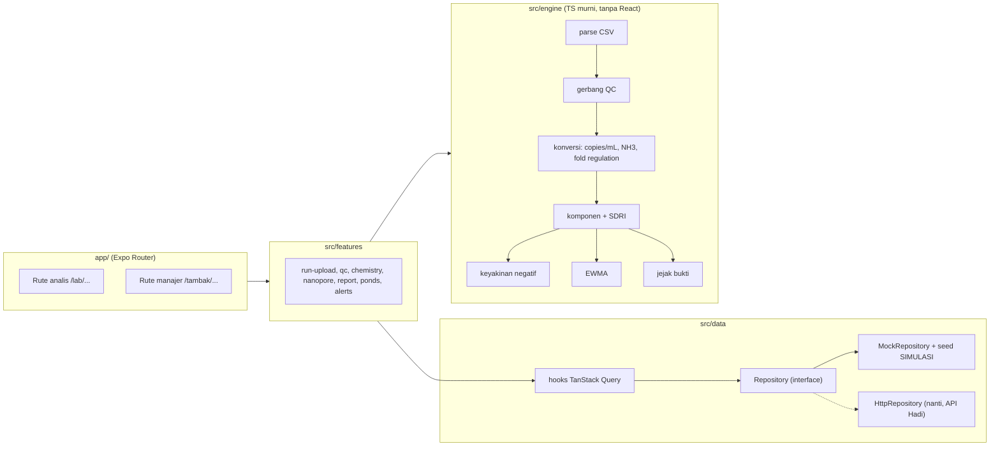

# 03 — ARCHITECTURE & Rencana Implementasi

> Turunan langsung dari 01-PRD (v1.0). ID task di sini = ID task di 04-TODO.
> Rumus skor: `docs/sdri-v1.md`. Komponen kaca: `docs/glass-surface-port.md`. Desain: `docs/08-DESIGN.md` (v2.1, ACC 24 Okt 2026).

## 1. Tech Stack

| Lapisan | Pilihan | Alasan |
|---|---|---|
| Bahasa | TypeScript (`strict: true`) | Mesin SDRI butuh tipe ketat; satu bahasa untuk semua |
| Framework | Expo SDK 58 + React Native (New Architecture) + Expo Router | Satu kode untuk Expo Go (iOS/Android) dan ekspor web; rute berbasis file sesuai peta halaman PRD |
| Database | Tidak ada (frontend saja). Mock disimpan di `AsyncStorage` | Backend milik Hadi; frontend memakai kontrak §5 |
| Data / state server | Pola **Repository** + TanStack Query v5 | Repository mock bisa ditukar ke API HTTP tanpa mengubah layar; Query mengurus cache, loading, galat |
| State UI | Zustand v5 | Peran aktif, filter, well yang dikeluarkan sebelum disimpan |
| Parsing CSV | `papaparse` | Teruji, jalan di RN dan web, tanpa dependensi native |
| Grafik | `react-native-svg` + komponen grafik buatan sendiri | Bawaan Expo, sama persis di HP dan web; pola grafik referensi (garis tren, meter kapsul, diagram alir) sederhana |
| Kaca | `expo-blur`, `expo-glass-effect`, `expo-linear-gradient` + port React Bits GlassSurface (web) | Lihat `docs/glass-surface-port.md` |
| Ikon | `lucide-react-native` | Satu keluarga ikon (aturan global) |
| Font | `expo-font` + Figtree (OFL, berkas lokal di `assets/fonts`, `font-display: swap` di web) | Pengganti bebas lisensi Gellix (font Iconly), lihat 08-DESIGN |
| Auth | Tidak ada. Pilih peran (demo) | Di luar scope PRD |
| Hosting / deploy | EAS Hosting (`expo export -p web` → `eas deploy`) | Resmi Expo, rute dinamis langsung jalan, gratis untuk demo |
| CI | Belum (hackathon). Skrip `npm run verify` lokal | Waktu ±36 jam; CI ditambah setelah lomba |
| Testing | `jest-expo` + `@testing-library/react-native` | Preset resmi Expo; mesin SDRI diuji murni tanpa UI |
| Lint / format / typecheck | `expo lint` (ESLint flat config) + Prettier + `tsc --noEmit` | Bawaan Expo |
| Dead code | `knip` | Menangkap file/ekspor yang tak terpakai |

## 2. Perintah Verifikasi

| Cek | Perintah |
|---|---|
| Install | `npm install` |
| Dev | `npx expo start` (tekan `w` untuk web) |
| Test | `npm test` (`jest`) |
| Build web | `npx expo export -p web` |
| Typecheck | `npx tsc --noEmit` |
| Lint | `npx expo lint` |
| Format | `npx prettier --check .` |
| Dead code | `npx knip` |
| Semua sekaligus | `npm run verify` (typecheck + lint + test) |
| Deploy web | `npx expo export -p web && npx eas-cli deploy` |
| Uji silang rumus | `python scripts/sdri_v1_check.py` (nilai acuan uji emas) |

## 3. Gambaran Arsitektur



Prinsip:
- **`src/engine` murni.** Tidak mengimpor React, Expo, atau penyimpanan. Masuk data mentah, keluar hasil + jejak. Inilah "otak" yang nanti bisa dipindah ke backend tanpa diubah.
- **Setiap angka membawa jejak.** Fungsi engine mengembalikan `{ value, trace }`, di mana `trace` berisi input, aturan (dengan ID aturan dari `sdri-v1.md`), dan sumbernya. Layar jejak bukti (P11) hanya merender `trace`.
- **Parameter terpisah dari logika.** Semua ambang, bobot, dan lantai ada di `src/engine/params/sdri-v1.ts` dengan versi. Mengubah kalibrasi = mengganti satu file + menaikkan versi.
- **Data SIMULASI ditandai di tipe.** Setiap entitas punya `provenance: 'simulasi' | 'nyata'`. UI wajib menampilkan badge bila `'simulasi'`.
- **Satu efek berat per layar** (kaca/animasi), dengan fallback reduced-motion/reduce-transparency.

**Struktur folder**

```
app/                       # rute (lihat 01-PRD §5b)
  _layout.tsx
  index.tsx                # P1 pilih peran
  lab/ ...                 # P2-P14
  tambak/ ...              # P15-P21
  pengaturan.tsx  tentang.tsx  simulator.tsx  +not-found.tsx
src/
  engine/
    params/sdri-v1.ts      # semua ambang/bobot
    types.ts               # masukan, Traced { value, trace }
    convert.ts             # kurva standar, copies/mL, NH3, fold regulation
    qc.ts                  # gerbang run + sampel
    sdri.ts                # 4 komponen + gabungan + kelas (evaluateSample)
    confidence.ts  ewma.ts
    parse/                 # parser CSV (T3.3)
    __tests__/             # termasuk golden.test.ts (5 arketipe GSI)
  data/
    types.ts  repository.ts  mock-repository.ts  http-repository.ts (stub)
    seed/                  # JSON SIMULASI: kolam, run, sampel, Nanopore
    queries.ts             # hook TanStack Query
  features/                # komponen per fitur
  ui/
    glass/GlassSurface.tsx  GlassSurface.web.tsx  GlassSurface.native.tsx
    charts/WaterColumnCard.tsx  AreaTrend.tsx  SegmentBar.tsx  PlateHeatmap.tsx  StandardCurve.tsx  TraceFlow.tsx
    primitives/            # Text, Card, Button, Badge, Pill, Sheet
    nav/BottomBar.tsx
    theme/tokens.ts        # dari 08-DESIGN
  store/ui.ts              # Zustand
scripts/                   # skrip Python acuan (sdri_v1_check.py, dll.)
docs/
```

## 4. Data Model

| Entitas | Field penting | Relasi |
|---|---|---|
| `Farm` | id, nama, lokasi | 1-n Pond |
| `Pond` | id, farmId, nama, sistem (`intensif` \| `bioflok`), tanggalTebar, DOC | 1-n Sample |
| `Run` | id, labNama, tanggal, alat, kurvaStandar: {slope, intercept, r2, efisiensi, titik[]}, status (`baru` \| `qc` \| `ditolak` \| `selesai`), provenance | 1-n Well, 1-n Sample |
| `Well` | id (`A1`..`H12`), runId, sampleId?, target (`pirA` \| `vp28` \| `swp1` \| `amoA` \| `16S` \| `PPC` \| `NTC` \| `GDC` \| `STD`), ct (number \| null = undetermined), tm, dikeluarkan?: {alasan, oleh, waktu} | n-1 Run |
| `Sample` | id, runId, pondId, kode (mis. `POND-TOX`), tanggalAmbil, peran (`acuan` \| `uji`), volumeAirMl, volumeElusiUl, volumeTemplateUl, gateStatus (`LULUS` \| `TINJAU` \| `DITOLAK`), alasanGate[] | 1-1 Chemistry, 0-1 Nanopore, 0-1 SdriResult |
| `Chemistry` | sampleId, suhu, pH, DO, TAN, nitrit, nitrat, H2S, TOM, alkalinitas, salinitas, fosfat; turunan: nh3, nh4 | 1-1 Sample |
| `NanoporeProfile` | sampleId, totalRead, takson[]: {nama, tingkat, read, kelimpahan}, shannon | 1-1 Sample |
| `SdriResult` | sampleId, versiParam, sPatho, sChem, sNitri, sMicro?, E, sdri, kelas, perTarget[]: {target, ct, nRxn, copiesMl, status, skor}, keyakinan[]: {target, peluang, saranSampel}, trace | 1-1 Sample |
| `Report` | id, sampleId, status (`draf` \| `terbit`), diterbitkanOleh, waktu, ringkasanWa | 1-1 Sample |
| `Alert` | id, pondId, sampleId, kelas, judul, dibuat, ditangani? | n-1 Pond |

Semua entitas punya `provenance: 'simulasi' | 'nyata'`.

**Seed SIMULASI:** 1 tambak, 5 kolam. Kelima arketipe GSI (CTRL, POND-BIO, POND-TOX, POND-REM, UNK-HUMIC) masing-masing menjadi sampel terbaru satu kolam, ditambah riwayat 6-8 minggu sintetis per kolam untuk tren EWMA dan profil Nanopore sintetis. Semua berlabel SIMULASI.

## 5. API / Antarmuka Utama

**Antarmuka Repository (frontend ↔ data)**

```ts
interface Repository {
  listRuns(filter?): Promise<Run[]>;
  getRun(id): Promise<RunDetail>;            // + wells + samples
  importRunCsv(csv: string, meta): Promise<ImportResult>;  // galat per baris
  excludeWell(runId, wellId, alasan): Promise<void>;
  saveChemistry(sampleId, data): Promise<Chemistry>;
  importNanoporeCsv(sampleId, csv): Promise<ImportResult>;
  getSample(id): Promise<SampleDetail>;      // + SdriResult
  publishReport(sampleId): Promise<Report>;
  listPonds(): Promise<PondSummary[]>;       // urut SDRI tertinggi
  getPond(id): Promise<PondDetail>;          // + riwayat SDRI & copies/mL
  listAlerts(): Promise<Alert[]>;
  resolveAlert(id): Promise<void>;
  getReport(id): Promise<ReportDetail>;
}
```

**Kontrak REST untuk backend (usulan ke Hadi, JSON, snake_case di wire)**

| Metode | Endpoint | Fungsi |
|---|---|---|
| GET | `/runs?status=` | Daftar run |
| POST | `/runs/import` | Unggah CSV qPCR (multipart) |
| GET | `/runs/{id}` | Detail run + well + sampel |
| POST | `/runs/{id}/wells/{well}/exclude` | Keluarkan well `{alasan}` |
| PUT | `/samples/{id}/chemistry` | Simpan kimia air |
| POST | `/samples/{id}/nanopore` | Unggah tabel kelimpahan |
| GET | `/samples/{id}` | Detail sampel + hasil SDRI + jejak |
| POST | `/samples/{id}/report/publish` | Terbitkan laporan |
| GET | `/ponds`, `/ponds/{id}` | Ringkasan dan detail kolam |
| GET | `/alerts`, POST `/alerts/{id}/resolve` | Peringatan |
| GET | `/reports/{id}` | Laporan terbit |

**Format CSV qPCR AquaSeq (v1):** `well,sample_code,target,ct_rep,tm` (satu baris per replikat; `ct` kosong/`Undetermined` = tidak teramplifikasi) + blok metadata kurva standar `std_level,copies_rxn,ct`. Detail dan contoh di P14.
**Format CSV Nanopore (v1, ala EPI2ME wf-16s/Emu):** `sample_code,taxon,rank,read_count,abundance`.

## 6. Rencana Implementasi

Prioritas: alur demo dulu (unggah → QC → SDRI → jejak → laporan → WA), lalu manajer, lalu Should/Could. Tiap task ≤ ~½-1 hari.

### Milestone M1 — Fondasi
| ID | Task | Fitur PRD | Kriteria selesai |
|---|---|---|---|
| T1.1 | Buat proyek Expo SDK 58 + TS strict, Expo Router, ESLint, Prettier, jest-expo, knip, skrip `verify` | — | `npm run verify` hijau; `npx expo start` membuka layar kosong di web dan Expo Go |
| T1.2 | Kerangka semua rute PRD (placeholder) + layout per peran | — | Semua 24 rute bisa dibuka; `+not-found` tampil untuk rute salah |
| T1.3 | Pasang dependensi stack (Query, Zustand, papaparse, svg, blur, glass-effect, linear-gradient, lucide) | — | Impor masing-masing tanpa galat di iOS/Android/web |

### Milestone M2 — Mesin SDRI v1
| ID | Task | Fitur PRD | Kriteria selesai |
|---|---|---|---|
| T2.1 | `params/sdri-v1.ts` + tipe hasil dan `trace` | F6 | Semua angka di `sdri-v1.md` §3-§6 ada di satu file berversi |
| T2.2 | Konversi: kurva standar (slope, efisiensi, R²), copies/mL, NH3, fold regulation | F4, F6 | Tes: efisiensi 98,84%; pirA POND-TOX 1,60e4 copies/mL; NH3 kelima sampel = tabel GSI (4 desimal) |
| T2.3 | Gerbang QC (PPC, kurva standar, NTC, 16S, SD replikat, read Nanopore, kimia wajib) | F2, F6 | Tes: UNK-HUMIC DITOLAK dengan alasan "PPC 24,46 > 22" |
| T2.4 | Komponen S_Patho, S_Chem, S_Nitri, S_Micro + gabungan + kelas | F6 | **Tes emas**: CTRL 0 Aman, POND-BIO 42,8 Waspada, POND-TOX 100 Kritis, POND-REM 80 Kritis (selisih ≤ 0,1 dari `sdri_v1_check.py`) |
| T2.5 | Keyakinan negatif + EWMA + rakit `trace` | F8, F10, F7 | Tes: 1/2/4/6 sampel = 45/70/91/97%; EWMA memberi sinyal pada deret uji yang naik |

### Milestone M3 — Data
| ID | Task | Fitur PRD | Kriteria selesai |
|---|---|---|---|
| T3.1 | `types.ts` + antarmuka Repository + hook Query | — | Typecheck hijau; hook dipakai satu layar contoh |
| T3.2 | Seed SIMULASI (5 kolam, arketipe GSI, riwayat 8 minggu, Nanopore sintetis) + MockRepository di AsyncStorage | F12 | Data muncul setelah muat ulang; tombol "reset data demo" di Pengaturan |
| T3.3 | Parser CSV qPCR + Nanopore dengan galat per baris + file contoh | F1, F5, F15 | Tes: CSV contoh terbaca; baris rusak memberi pesan berisi nomor baris |

### Milestone M4 — UI dasar (setelah 08-DESIGN di-ACC)
| ID | Task | Fitur PRD | Kriteria selesai |
|---|---|---|---|
| T4.1 | Token tema dari 08-DESIGN + primitif (Text, Card, Button, Badge SIMULASI, Pill, Sheet) | F12 | Kontras teks lolos AA; badge SIMULASI tidak bisa disembunyikan |
| T4.2 | GlassSurface (web port, native: GlassView/BlurView/gradien) | — | Tampil di web Chromium (refraksi), Safari (frosted), iOS, Android (blur dimezis); fallback reduce-transparency |
| T4.3 | BottomBar kaca + tombol tengah per peran | — | Navigasi semua tab; label aksesibilitas; area sentuh ≥ 44 pt |
| T4.4 | Grafik SVG: WaterColumnCard (kartu kolom air SDRI), AreaTrend (+ zona EWMA), SegmentBar, PlateHeatmap, StandardCurve, TraceFlow | F2, F7, F8, F10 | Render sama di web dan HP; setiap grafik punya ringkasan teks untuk pembaca layar |

### Milestone M5 — Alur analis (demo inti)
| ID | Task | Fitur PRD | Kriteria selesai |
|---|---|---|---|
| T5.1 | P1 pilih peran + P2 antrian run | — | Peran tersimpan; antrian menampilkan status run |
| T5.2 | P3 unggah run | F1 | Unggah CSV contoh → run baru muncul; CSV rusak → daftar galat per baris |
| T5.3 | P4 ruang QC + P5 kurva standar | F2 | Heatmap plate, status PPC/NTC/GDC, efisiensi, R²; run gagal kurva standar → status ditolak |
| T5.4 | P6 detail well + keluarkan well | F3 | Alasan wajib; SDRI dihitung ulang; tercatat di jejak |
| T5.5 | P7 daftar sampel + P8 kimia + P9 Nanopore | F4, F5 | NH3 tampil langsung saat mengetik; read < 5.000 → TINJAU |
| T5.6 | P10 hasil SDRI + P11 jejak bukti | F6, F7, F8 | Kartu kolom air + komponen + rekomendasi; dari skor dapat diketuk sampai well |
| T5.7 | P12 tinjau & terbitkan | F9 | Draf → Terbit; sampel DITOLAK tidak bisa diterbitkan |

### Milestone M6 — Alur manajer
| ID | Task | Fitur PRD | Kriteria selesai |
|---|---|---|---|
| T6.1 | P15 beranda kolam | F10 | Kartu urut SDRI tertinggi, kelas + ikon + label |
| T6.2 | P16 detail kolam + P17 detail patogen | F8, F10 | Tren EWMA berlabel "sinyal tren"; keyakinan negatif per patogen ND |
| T6.3 | P18 pusat peringatan | F10 | Peringatan dari sampel Waspada/Kritis; tandai ditangani |
| T6.4 | P19 laporan + P20 pratinjau WA | F11 | Teks ≤ 600 karakter, Bahasa Indonesia; tombol salin berfungsi di web dan HP |

### Milestone M7 — Rilis demo
| ID | Task | Fitur PRD | Kriteria selesai |
|---|---|---|---|
| T7.1 | P23 tentang & disclaimer + halaman error/offline | F12 | Status data, batas klaim, decision support tertulis |
| T7.2 | Audit a11y + kontras + reduced motion di 6 layar demo | — | Semua teks AA; VoiceOver/TalkBack membaca kartu kolom air SDRI sebagai kalimat |
| T7.3 | Ekspor web + deploy EAS Hosting + uji Expo Go di 1 iPhone dan 1 Android | — | Link publik hidup; alur demo jalan tanpa galat di 3 platform |
| T7.4 | Naskah demo 6 menit + data demo terkunci | — | Gladi 2× ≤ 6 menit |

### Milestone M8 — Should / Could (bila waktu cukup)
| ID | Task | Fitur PRD | Kriteria selesai |
|---|---|---|---|
| T8.1 | P13 riwayat run + P14 panduan format | F14, F15 | Filter status; unduh contoh CSV |
| T8.2 | P21 banding kolam + P22 pengaturan | F13 | 2-4 kolam berdampingan |
| T8.3 | P24 simulator skenario | F17 | Geser input → SDRI berubah, label SIMULASI |
| T8.4 | Ekspor PDF laporan | F16 | PDF berisi skor, komponen, jejak ringkas |

## 7. Q&A Keputusan

| # | Pertanyaan | Jawaban / Keputusan | Tanggal |
|---|---|---|---|
| Q1 | Platform & stack | Expo (React Native) + TS + ekspor web | 23 Okt 2026 |
| Q2 | Cakupan | Frontend saja; backend Hadi, mock berkontrak JSON | 23 Okt 2026 |
| Q3 | Input data | qPCR dan Nanopore sama-sama inti + kimia air | 23 Okt 2026 |
| Q4 | Rumus skor | SDRI v1 dikunci (kerangka GSI + penggabungan berbasis literatur), indeks 0-100, bukan probabilitas | 23 Okt 2026 |
| Q5 | Grafik | react-native-svg, grafik ditulis sendiri | 23 Okt 2026 |
| Q6 | Lapisan data | Repository + TanStack Query + Zustand | 23 Okt 2026 |
| Q7 | Format Nanopore | Tabel kelimpahan CSV ala EPI2ME wf-16s/Emu | 23 Okt 2026 |
| Q8 | Hosting | EAS Hosting | 23 Okt 2026 |
| Q9 | Kaca | GlassSurface 3 implementasi (web React Bits, iOS 26 GlassView, BlurView iOS lama/Android dimezis); refraksi native Skia ditunda | 23 Okt 2026 |
| Q10 | Gaya | Desain v2.1 dari 378 shot Iconly Pro (Dribbble): kaca terang di kanvas abu + bloom pastel, UI monokrom hitam-abu, satu aksen teal solid (FAB), ubin pintasan kaca transparan, font Figtree, ikon Lucide, kartu kolom air untuk SDRI, nav pil kaca + tombol tengah. Menggantikan v1 (soft UI aksen biru, pita biru) | 24 Okt 2026 |

## 8. Pertanyaan Terbuka

- Data 5 arketipe GSI nyata atau simulasi? (menentukan label; default SIMULASI)
- Keputusan tim POND-BIO (Waspada) dan POND-REM (Kritis) — bila berubah, naikkan versi parameter.
- Format ekspor asli alat lab GSI (kolom CSV), untuk menyesuaikan parser T3.3.
- Lisensi React Bits untuk port GlassSurface (cek sebelum T4.2).
